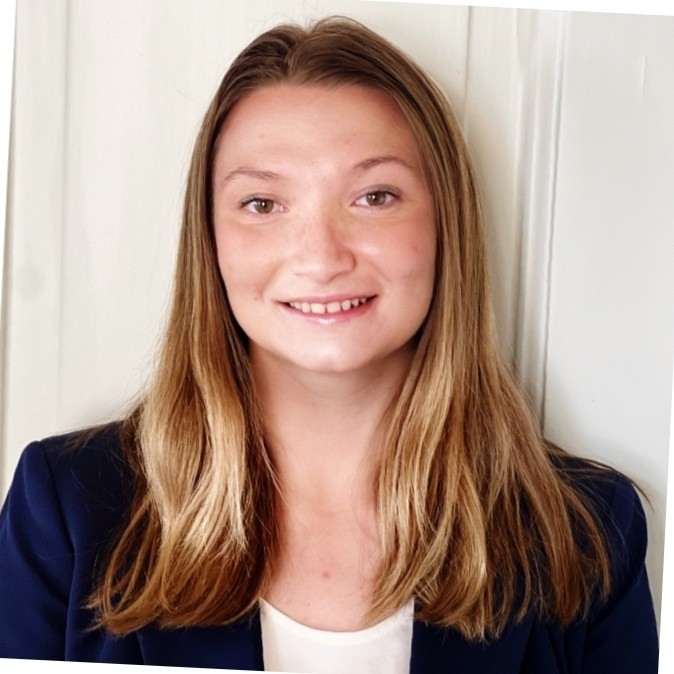

{fig-align="center" width="200" style="border-radius: 50%;"}

## Personal Background

I have always considered myself adaptable and someone who engages thoroughly with my surroundings. I grew up in Philadelphia, where my love of sports and history developed early. I played baseball until high school and was the only girl on the team. I have always been and will always be a dedicated Phillies fan. In 2018, my family moved to Oslo, Norway, where I completed the International Baccalaureate (IB) Diploma Programme and competed in cross-country skiing at a national level with the historic Lyn Ski Klubb. While in Norway I became fluent in Norwegian and still maintain that fluency to this day. I returned to the US for college and attended St. Lawrence University (SLU) where I double majored in Data Science and History. In May 2026 I graduated *cum laude* with honors with a Bachelor of Science degree. I am back in Philly now and am super excited to see what this next chapter holds either here or somewhere else!

## Academic & Professional Background

I made the most of my time at SLU, both academically and with a series of extracurricular commitments. I was a dedicated member of the women’s rowing team which strengthened my teamwork along with discipline and time management skills. I worked on ESPN broadcasts in the media room during our Division I hockey games, allowing me to channel my interest in sports in a challenging and high stakes environment. I also worked as an Admissions Ambassador which offered a chance for me to share my love of SLU with prospective students and their families. In the summer of 2024, I was awarded an NSF-funded fellowship in which I worked with the data science department on creating data modules for the [SCORE network](https://data.scorenetwork.org){target="_blank"}. These modules consisted of data science exercises I created based on data I scraped from a variety of sports of my choice. The next summer I was awarded a fellowship at Temple University in which I participated in the STEM-UP summer program, teaching high school students data science and mathematics. I leveraged the skills I developed in both of these fellowships along with skills from the classroom to work on my [honors thesis](https://laurens-hamilton-project.quarto.pub/laurens-hamilton-project/){target="_blank"} my senior year.

In my thesis, I combined both of my majors by creating a large language model and applying it to the historical correspondence of Alexander Hamilton and John Laurens alongside traditional historical analysis.

